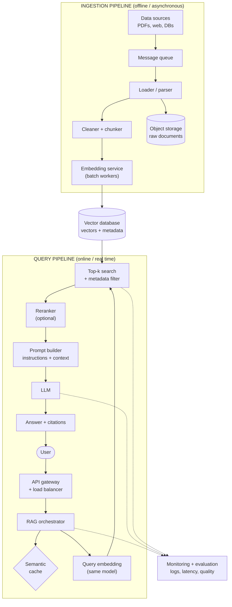

# RAG Pipeline Project Notes

A from-scratch "Ask my documents" app in Python, built step by step with free tools (sentence-transformers, NumPy, Ollama). No frameworks, so every stage is visible.

---

## 1. What is RAG?

An LLM only knows its training data. It knows nothing about private files or recent events, and when asked, it may guess. **Retrieval-Augmented Generation (RAG)** fixes this by fetching relevant text at question time and putting it in the prompt.

1. **Retrieve**: embed the question, find the most similar chunks.
2. **Augment**: paste those chunks into the prompt with instructions.
3. **Generate**: the LLM answers using the provided context.

RAG _reduces_ hallucinations but does not eliminate them. Bad retrieval or a model that ignores the instructions can still produce wrong answers.

---

## 2. Project pipeline

| Step | File                                  | What it does                                                       |
| ---- | ------------------------------------- | ------------------------------------------------------------------ |
| 1    | `step1_load.py`                       | Reads `.txt` files into dicts with `source` and `text`             |
| 2    | `step2_chunk.py`                      | Splits text into overlapping chunks                                |
| 3    | `step3_embed.py`                      | Turns chunks into 384-number vectors (`all-MiniLM-L6-v2`)          |
| 4    | `step4_retrieve.py`                   | `VectorStore`: dot product of query vector vs chunk vectors, top-k |
| 5    | `step5_prompt.py`, `step5b_answer.py` | Score threshold, prompt building, Ollama generation                |
| 6    | (next)                                | Evaluation and improvements                                        |

**Packages and why**

- `sentence-transformers`: the embedding model (text to vectors). Pulls in PyTorch.
- `numpy`: the math for similarity search.
- `ollama`: Python client for the local LLM server.

**Key concepts learned**

- **Embedding**: a fixed-length vector (384 numbers) that represents meaning. Similar meaning gives nearby vectors.
- **Normalization**: scaling vectors to length 1, so cosine similarity equals the dot product.
- **Cosine similarity**: near 1 means very similar, near 0 means unrelated.
- **Same model for chunks and queries**: otherwise the vectors live in different spaces and comparisons are meaningless.
- **Score threshold**: retrieval always returns the top-k, even when nothing is relevant (France question scored about 0.08 versus 0.69 for good matches). The threshold lets us skip the LLM when nothing relevant exists.

**Observed weaknesses**

- Fixed-size chunks start and end mid-word (`ur body that long...`).
- Retrieved chunks arrive in score order, not reading order.
- A threshold of 0.3 let an irrelevant tea chunk through; no value separates "on-topic" from "vaguely related" perfectly.

---

## 3. Chunking strategies and trade-offs

Chunking decides what each vector represents. Too large gives blurry meaning and wasted prompt space. Too small loses context (a chunk saying "It was first consumed in China" no longer says what "it" is).

### Strategy A: Fixed-size chunking with overlap (what we built)

Cut every N characters (or tokens), repeating the last M characters in the next chunk.

| Pros                                           | Cons                                                                |
| ---------------------------------------------- | ------------------------------------------------------------------- |
| Very simple, fast, predictable chunk sizes     | Cuts words and sentences in half                                    |
| Works on any text, no parsing needed           | Ignores document structure and meaning                              |
| Overlap rescues ideas that straddle a boundary | Overlap duplicates text (more storage, repeated content in prompts) |

### Strategy B: Sentence- or paragraph-based chunking

Split on sentence or paragraph boundaries, then group sentences until a size limit is reached.

| Pros                                   | Cons                                                                |
| -------------------------------------- | ------------------------------------------------------------------- |
| Chunks are complete, readable thoughts | Chunk sizes vary widely                                             |
| Better embeddings, cleaner prompts     | Needs a sentence splitter (can fail on abbreviations, code, tables) |
| Easy to cite exactly                   | One very long paragraph can still exceed the model's input limit    |

### Strategy C: Recursive chunking

Try the largest separator first (paragraphs), then lines, then sentences, then words, only splitting further when a piece is still too big. A common default in practice.

| Pros                                                     | Cons                                |
| -------------------------------------------------------- | ----------------------------------- |
| Respects structure where possible, falls back gracefully | More code and more settings to tune |
| Chunk sizes stay close to a target                       | Still not "meaning-aware"           |

### Strategy D: Semantic chunking

Embed sentences and start a new chunk where the meaning shifts (similarity between neighbors drops).

| Pros                                       | Cons                                               |
| ------------------------------------------ | -------------------------------------------------- |
| Chunks follow topics, not character counts | Slower: requires embedding during ingestion        |
| Often the best retrieval quality           | Needs a threshold to tune; sizes are unpredictable |

**Rule of thumb:** start with recursive or sentence-based chunking at roughly 200 to 500 tokens with 10 to 20 percent overlap, then measure with a test set instead of guessing.

---

## 4. ChromaDB vs FAISS

Both do similarity search over vectors, but they are different kinds of tool.

- **FAISS** (Facebook/Meta AI Similarity Search) is a **library**. It builds an index of vectors and returns the IDs and distances of the nearest ones. That is all it does.
- **ChromaDB** is a **vector database**. It stores vectors _and_ the original text and metadata, handles persistence, and lets you query with filters.

|                       | FAISS                                                     | ChromaDB                                                 |
| --------------------- | --------------------------------------------------------- | -------------------------------------------------------- |
| Type                  | Search library                                            | Database                                                 |
| Stores                | Vectors only (returns integer IDs)                        | Vectors, documents, and metadata                         |
| Metadata filtering    | Not built in; you manage it yourself                      | Built in (e.g. `where={"source": "tea.txt"}`)            |
| Persistence           | Manual (`write_index` / `read_index`)                     | Built in (persistent client)                             |
| Add / update / delete | Limited, depends on index type                            | Straightforward CRUD                                     |
| Index types           | Many: Flat (exact), IVF, HNSW, PQ compression             | HNSW-based approximate search                            |
| Scale and speed       | Excellent; billion-scale, optional GPU                    | Good for small to medium collections                     |
| Setup effort          | More code (you glue text, IDs, and metadata)              | Quick start, fewer lines                                 |
| Best for              | Maximum performance, research, large-scale custom systems | Prototypes, apps that need metadata and easy persistence |

**How this relates to our project:** our NumPy `VectorStore` does exactly what FAISS's exact "Flat" index does (compare the query against every vector). We keep chunks in a Python list aligned with the array; FAISS would give us the row numbers, and we would do that lookup ourselves. Chroma would do the lookup for us and store the text and `source` alongside the vectors.

**When to switch:** brute force is fine up to tens of thousands of chunks. Beyond that, move to an approximate index (FAISS IVF/HNSW) or a database (Chroma for simplicity; hosted or distributed options such as Qdrant, Weaviate, Milvus, or pgvector for production scale).

---

## 5. Scalable RAG architecture

A production system separates the **offline ingestion path** (runs when documents change) from the **online query path** (runs for every user question), so each can scale independently.

**Components**

| Component                   | Role                                               | How it scales                                        |
| --------------------------- | -------------------------------------------------- | ---------------------------------------------------- |
| Data sources                | PDFs, web pages, databases, wikis                  | Connectors per source                                |
| Message queue               | Buffers ingestion jobs                             | Absorbs bursts; decouples producers and workers      |
| Loader / parser             | Extracts text and metadata                         | Parallel workers                                     |
| Cleaner and chunker         | Normalizes text, splits into chunks                | Stateless, add more workers                          |
| Embedding service           | Turns chunks and queries into vectors              | Batching, GPU workers, horizontal scaling            |
| Object storage              | Keeps raw documents                                | Cheap, practically unlimited                         |
| Vector database             | Stores vectors and metadata, serves top-k search   | Sharding, replicas, approximate indexes              |
| API gateway / load balancer | Entry point, auth, rate limits                     | Horizontal scaling                                   |
| RAG orchestrator            | Runs the query flow                                | Stateless, autoscaled                                |
| Semantic cache              | Reuses answers to repeated or similar questions    | Cuts cost and latency                                |
| Reranker (optional)         | Re-scores the top candidates more accurately       | Run on a small set (top 20 to 50)                    |
| Prompt builder              | Orders chunks, adds instructions and sources       | Cheap, in-process                                    |
| LLM                         | Generates the grounded answer                      | Hosted API or a GPU inference cluster                |
| Monitoring and evaluation   | Logs queries, latency, retrieval quality, feedback | Feeds improvements back into chunking and thresholds |

---

## 6. Architecture diagram (Mermaid)

Mermaid renders in GitHub, GitLab, Obsidian, VS Code (with a Markdown Mermaid extension), and Notion code blocks. To get an image, paste it into https://mermaid.live and export PNG or SVG.

---

## 7. Next steps (Step 6)

- Switch to sentence-based or recursive chunking and compare results.
- Sort retrieved chunks into reading order before building the prompt.
- Build a small test set of questions with expected answers and measure changes.
- Investigate the "caffeine in coffee" trap: does the model admit it doesn't know, misuse the tea number, or use outside knowledge?
- Try the same pipeline with FAISS or ChromaDB and compare with the NumPy version.

---

## 8. My own observations

_Write your own results here: scores you saw, answers the LLM gave, what surprised you, and what you changed._
